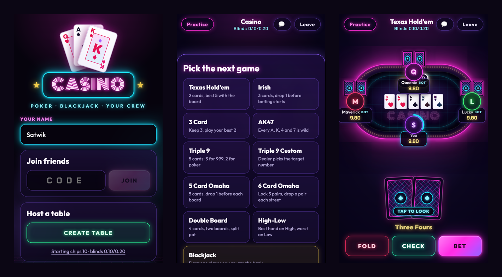

# Casino

**Poker and blackjack for a group of friends, on their phones.** One person hosts a table, everyone joins with a 4-letter code, and the dealer picks the game each hand.

**[Play it → casino.satwikmedipalli.dev](https://casino.satwikmedipalli.dev)** (open it on a phone and add it to the home screen; the first load can take up to a minute while the free server wakes up)



No app store, no accounts, no real money: everyone starts with play chips, and you settle up however your group likes.

## Games

The dealer rotates every hand and chooses from 11 games, including house rules my friends actually play:

| Game | How it works |
|---|---|
| Texas Hold'em | 2 cards, best 5 with the board |
| Irish | 3 cards, drop 1 before the flop |
| 3 Card | Keep all 3, play your best 2 with the board |
| AK47 | Hold'em where every A, K, 4 and 7 is wild |
| Triple 9 | 5 cards: 3 make a number closest to 999, 2 play poker. Split pot |
| Triple 9 Custom | The dealer picks the target, or "farthest wins" |
| 5 Card Omaha | Drop a card before each new board card, down to 2 at the river |
| 6 Card Omaha | Lock in 3 pairs, then drop a pair after the flop and after the turn |
| Double Board | 4 cards and two boards: one pair plays each board. Split pot |
| High-Low | Two boards: best hand on High, worst hand on Low. Split pot |
| Blackjack | The player who picks it is the bank. 2-deck shoe, double, split, insurance, blackjack pays 3:2 |

In the split-pot games you can rearrange your cards until showdown. Games are greyed out when there are more players than the deck can deal.

## What's in it

- **Practice mode**: play any game against 1–7 bots, no friends needed.
- **Table chat** with quick phrases and 12 animated emotes.
- **Neon table**: the rim glows toward whoever's turn it is, cards are holographic, and every showdown ends in fireworks (bigger when you win).
- **Built for phones**: tap your cards to look, a turn timer that doesn't make everyone wait on a sleeping phone, and automatic reconnect when iOS drops the connection in the background.

## How it works

- **The server is the dealer.** It shuffles, deals and runs every hand. Each phone only ever receives its own cards; other players' cards are sent only when they're revealed at showdown (`server/table.ts`). Nobody can read anyone else's hand from the browser.
- **Real-time over WebSockets.** One Node server serves the app and runs every table in memory. Phones reconnect to their seat with a token if they drop.
- **One hand evaluator for every variant**: best 5 of any cards, a "use exactly N hole cards" rule for Omaha, wild cards for AK47, and lowest-hand ranking for High-Low.
- **Tested**: 25 engine tests cover hand ranking, wild cards, side pots with multiple all-ins, every variant's rules, blackjack payouts and table chat. Two of them let bots play 200 hands of every game and 200 rounds of blackjack, and check that no chips are ever created or lost.

## Stack

TypeScript · React · Vite · Node · Express · WebSockets (`ws`) · hosted on Render

## Run it locally

```
npm install
npm run dev      # server on :3001, app on :5173 (open from phones on the same Wi-Fi)
npm test         # game engine tests
npm run build && npm start   # production: one server on $PORT serves app + game
```

Deployed from `render.yaml` as a Render Blueprint. Tables live in memory, so a restart (or the free plan going to sleep after about 15 idle minutes) ends any game in progress.
